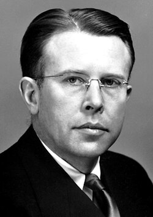

# 欧内斯特·劳伦斯

**英文名：** Ernest Orlando Lawrence

**生卒：** 1901年8月8日 — 1958年8月27日

**主要领域：** 加速器物理、核物理

肖像的作者、拍摄或创作年代及具体形式见图片来源。

## 生平简介

欧内斯特·劳伦斯出生于Canton, SD, USA，主要从事加速器物理、核物理研究。诺贝尔奖资料所列获奖时任职机构为University of California。其代表成果包括发明并发展回旋加速器，获1939年诺贝尔物理学奖。

## 对物理的主要贡献

- 发明并发展回旋加速器
- 使较高能量带电粒子束成为研究原子核的实验工具

**诺贝尔物理学奖：** 1939

## 肖像来源与许可

- 来源：[Ernest_Lawrence.jpg](https://commons.wikimedia.org/wiki/File:Ernest_Lawrence.jpg)
- 作者／署名：Nobel foundation
- 许可：Public domain
- 本地文件：[2c426b3a38548da57a58.jpg](../portraits/2c426b3a38548da57a58.jpg)
- 原始来源说明：http://nobelprize.org/nobel_prizes/physics/laureates/1939/lawrence-bio.html

## 资料来源

- [Ernest Lawrence - Facts](https://www.nobelprize.org/prizes/physics/1939/lawrence/facts/)
- [Nobel Prize official laureate API, id 47](https://api.nobelprize.org/2.1/laureate/47)
- [Wikipedia: Ernest Lawrence](https://en.wikipedia.org/wiki/Ernest_Lawrence)

资料整理日期：2026-10-26。
