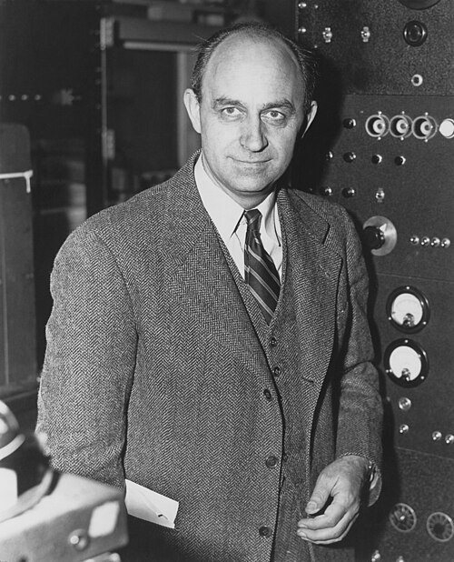

# 恩里科·费米

**英文名：** Enrico Fermi

**生卒：** 1901年9月29日 — 1954年11月28日

**主要领域：** 核物理、中子物理

肖像的作者、拍摄或创作年代及具体形式见图片来源。

## 生平简介

恩里科·费米出生于Rome, Italy，主要从事核物理、中子物理研究。诺贝尔奖资料所列获奖时任职机构为Rome University。其代表成果包括利用中子轰击研究核反应与人工放射性，获1938年诺贝尔物理学奖。

## 对物理的主要贡献

- 利用中子轰击研究核反应与人工放射性
- 发现慢中子更易引起某些核反应

**诺贝尔物理学奖：** 1938

## 肖像来源与许可

- 来源：[Enrico_Fermi_1943-49.jpg](https://commons.wikimedia.org/wiki/File:Enrico_Fermi_1943-49.jpg)
- 作者／署名：Department of Energy-Office of Public Affairs, restored by Yann
- 许可：Public domain
- 本地文件：[44a4610c21f4c668b353.jpg](../portraits/44a4610c21f4c668b353.jpg)
- 原始来源说明：This tag does not indicate the copyright status of the attached work. A normal copyright tag is still required. See Commons:Licensing.

## 资料来源

- [Enrico Fermi - Facts](https://www.nobelprize.org/prizes/physics/1938/fermi/facts/)
- [Nobel Prize official laureate API, id 46](https://api.nobelprize.org/2.1/laureate/46)
- [Wikipedia: Enrico Fermi](https://en.wikipedia.org/wiki/Enrico_Fermi)

资料整理日期：2026-10-26。
