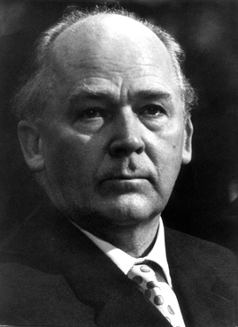

# 弗里茨·施特拉斯曼

**英文名：** Fritz Strassmann

**生卒：** 1902年2月22日 — 1980年4月22日

**主要领域：** 核物理、核化学

肖像的作者、拍摄或创作年代及具体形式见图片来源。

## 生平简介

德国核化学家，在柏林威廉皇帝化学研究所与奥托·哈恩和莉泽·迈特纳合作。1938年底，他与哈恩得到铀受中子照射后产生钡的化学证据；战后在美因茨大学建设化学与核化学研究。

## 对物理的主要贡献

- 与哈恩以放射化学分析确认中子照射铀产生钡，为核裂变的发现提供关键实验依据
- 发展分离、鉴定放射性核素及研究裂变产物的化学方法
- 参与建立美因茨大学的化学和核化学研究机构

## 史料说明

- 哈恩与施特拉斯曼给出化学实验证据，迈特纳与奥托·罗伯特·弗里施随后给出核裂变的物理解释。

## 肖像来源与许可

- 来源：[final-nuclear-fritz-strassmann.jpg](https://en.wikipedia.org/wiki/File:Fritz_Strassmann.jpg)
- 作者／署名：见原图页面
- 许可：Non-free historical photograph hosted by English Wikipedia under its fair-use rationale; that rationale does not grant a reusable image licence. Permission must be confirmed before website publication.
- 本地文件：[949af6868ba6a3263830-a1604a9396.jpg](../portraits/949af6868ba6a3263830-a1604a9396.jpg)
- 原始来源说明：Leibniz University Hannover alumni biography photograph, reproduced on English Wikipedia; photographer unknown
- 授权状态：仅记录来源与本地档案副本；未确认可用于网站再发布，发布前须向权利人核实授权。

## 资料来源

- [Max Planck Society archive — Fritz Strassmann biography](https://www.archiv-berlin.mpg.de/49031/hausreihe_22.pdf)
- [Max Planck Institute for Chemistry — Fritz Strassmann](https://www.mpic.de/3546641/1949-1953)
- [Mainz University — founding chemistry professors](https://presse.uni-mainz.de/ut-omnes-unum-sint-gruendungsprofessoren-der-chemie-und-pharmazie/)
- [Fritz Strassmann — reference biography](https://en.wikipedia.org/wiki/Fritz_Strassmann)

资料整理日期：2026-10-26。
