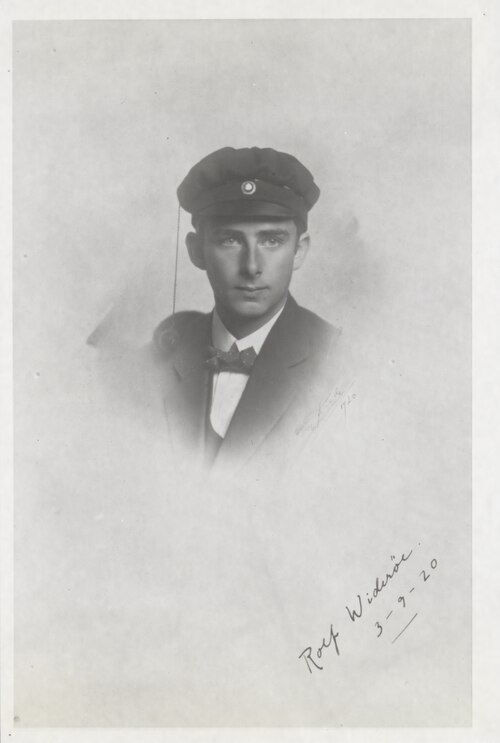

# 罗尔夫·维德勒

**英文名：** Rolf Widerøe

**生卒：** 1902年7月11日 — 1996年10月11日

**主要领域：** 加速器物理

肖像的作者、拍摄或创作年代及具体形式见图片来源。

## 生平简介

挪威物理学家和工程师，曾在德国学习并长期从事加速器研究。他的早期论文与实验启发了后来多种高能加速器，晚年也推动放射治疗用加速器的发展。

## 对物理的主要贡献

- 早期提出并验证射频直线加速原理
- 提出电子感应加速的基本条件，并研究电子感应加速器技术
- 推动粒子加速器用于医学放射治疗

## 肖像来源与许可

- 来源：[ETH-BIB-Wideröe,_Rolf_(1902-1996)-Portr_12854.tif](https://commons.wikimedia.org/wiki/File:ETH-BIB-Wider%C3%B6e,_Rolf_(1902-1996)-Portr_12854.tif)
- 作者／署名：Unbekannt
- 许可：[CC BY-SA 4.0](https://creativecommons.org/licenses/by-sa/4.0)
- 本地文件：[ec10783b7093ef4d0ef7.jpg](../portraits/ec10783b7093ef4d0ef7.jpg)
- 原始来源说明：This image is from the collection of the ETH-Bibliothek and has been published on Wikimedia Commons as part of a cooperation with Wikimedia CH. Corrections and additional information are welcome.

## 资料来源

- [Wikipedia: Rolf Widerøe](https://en.wikipedia.org/wiki/Rolf_Wider%C3%B8e)

资料整理日期：2026-10-26。
