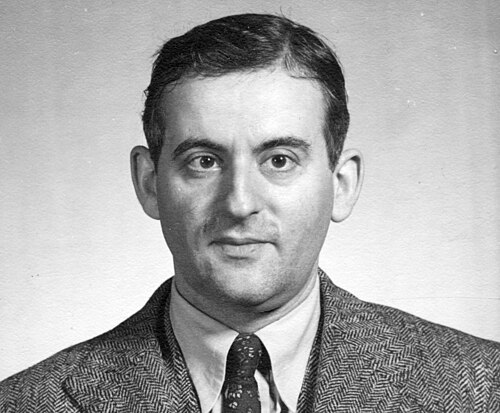

# 塞缪尔·古兹米特

**英文名：** Samuel Goudsmit

**生卒：** 1902年7月11日 — 1978年12月4日

**主要领域：** 原子物理、量子力学

肖像的作者、拍摄或创作年代及具体形式见图片来源。

## 生平简介

荷兰出生的物理学家，先在莱顿大学研究原子光谱，后移居美国，曾任职密歇根大学和布鲁克海文国家实验室。他也长期承担物理学期刊编辑工作，促进战后学术交流。

## 对物理的主要贡献

- 与乌伦贝克共同提出电子自旋概念
- 研究原子光谱结构与量子数
- 推动原子和核物理研究及学术出版

## 肖像来源与许可

- 来源：[Goudsmit_Samuel_A6.jpg](https://commons.wikimedia.org/wiki/File:Goudsmit_Samuel_A6.jpg)
- 作者／署名：AIP Emilio Segrè Visual Archives, Goudsmit Collection
- 许可：Public domain
- 本地文件：[f1e84780ce2b9991198e.jpg](../portraits/f1e84780ce2b9991198e.jpg)
- 原始来源说明：https://repository.aip.org/islandora/object/nbla%3A297076

## 资料来源

- [Wikipedia: Samuel Goudsmit](https://en.wikipedia.org/wiki/Samuel_Goudsmit)

资料整理日期：2026-10-26。
