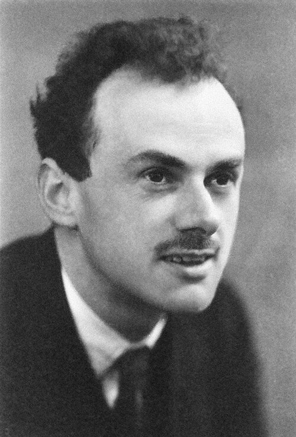

# 保罗·狄拉克

**英文名：** Paul Adrien Maurice Dirac

**生卒：** 1902年8月8日 — 1984年10月20日

**主要领域：** 量子力学、量子场论

肖像的作者、拍摄或创作年代及具体形式见图片来源。

## 生平简介

保罗·狄拉克出生于Bristol, United Kingdom，主要从事量子力学、量子场论研究。诺贝尔奖资料所列获奖时任职机构为University of Cambridge。其代表成果包括建立同时符合量子力学和狭义相对论的狄拉克方程，获1933年诺贝尔物理学奖。

## 对物理的主要贡献

- 建立同时符合量子力学和狭义相对论的狄拉克方程
- 预言反物质，并发展量子场论的基本理论工具

**诺贝尔物理学奖：** 1933

## 肖像来源与许可

- 来源：[Paul_Dirac,_1933.jpg](https://commons.wikimedia.org/wiki/File:Paul_Dirac%2C_1933.jpg)
- 作者／署名：Nobel Foundation
- 许可：Public domain
- 本地文件：[863838fb6f8f916447f1.jpg](../portraits/863838fb6f8f916447f1.jpg)
- 原始来源说明：http://nobelprize.org/nobel_prizes/physics/laureates/1933/dirac.html

## 资料来源

- [Paul A.M. Dirac - Facts](https://www.nobelprize.org/prizes/physics/1933/dirac/facts/)
- [Nobel Prize official laureate API, id 40](https://api.nobelprize.org/2.1/laureate/40)
- [Wikipedia: Paul Dirac](https://en.wikipedia.org/wiki/Paul_Dirac)

资料整理日期：2026-10-26。
