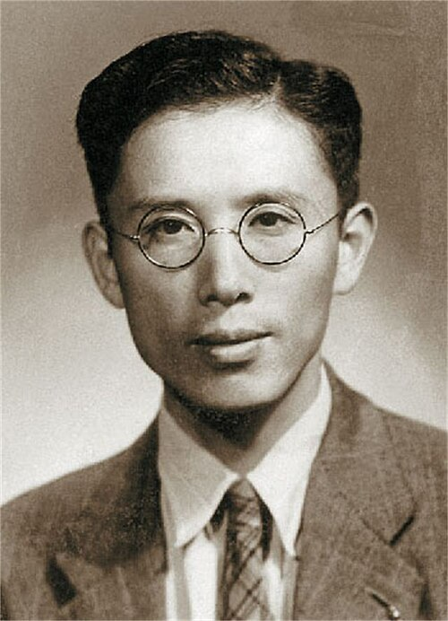

# 周培源

**英文名：** Zhou Peiyuan

**生卒：** 1902年8月28日 — 1993年11月24日

**主要领域：** 流体力学、广义相对论

肖像的作者、拍摄或创作年代及具体形式见图片来源。

## 生平简介

出生于江苏宜兴的理论物理学家和力学家，曾在芝加哥、加州理工学院及欧洲学习研究，长期任教于清华大学与北京大学。他研究湍流和引力理论，并参与中国科学教育建设。

## 对物理的主要贡献

- 研究湍流雷诺应力及其输运方程
- 研究广义相对论中的引力场解
- 推动流体力学、理论物理教学与人才培养

## 肖像来源与许可

- 来源：[中年周培源.jpg](https://commons.wikimedia.org/wiki/File:%E4%B8%AD%E5%B9%B4%E5%91%A8%E5%9F%B9%E6%BA%90.jpg)
- 作者／署名：Unknown author
- 许可：Public domain
- 本地文件：[bf1944e480811eed6a7a.jpg](../portraits/bf1944e480811eed6a7a.jpg)
- 原始来源说明：https://pubs.cstam.org.cn/data/article/yysxhlx/preview/pdf/2017-10-1081.pdf

## 资料来源

- [清华大学：周培源先生生平](https://www.tsinghua.edu.cn/info/2013/78175.htm)
- [Wikipedia: Zhou Peiyuan](https://en.wikipedia.org/wiki/Zhou_Peiyuan)

资料整理日期：2026-10-26。
