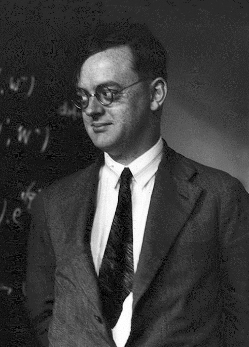

# 帕斯夸尔·约尔当

**英文名：** Pascual Jordan

**生卒：** 1902年10月18日 — 1980年7月31日

**主要领域：** 量子力学、量子场论

肖像的作者、拍摄或创作年代及具体形式见图片来源。

## 生平简介

德国理论物理学家，曾在哥廷根与玻恩、海森堡合作，后在罗斯托克、柏林和汉堡任教。他参与建立量子力学与场量子化，并研究代数和引力理论。

## 对物理的主要贡献

- 参与建立矩阵力学及正则量子化方法
- 发展费米子的反对易关系与场量子化
- 提出约尔当代数，并研究标量张量引力理论

## 史料说明

- 1933年加入纳粹党，战后亦参与政治活动；其科学贡献与这一历史背景均应如实呈现。

## 肖像来源与许可

- 来源：[Pascual_Jordan_1920s.jpg](https://commons.wikimedia.org/wiki/File:Pascual_Jordan_1920s.jpg)
- 作者／署名：Unknown (Mondadori Publishers)
- 许可：Public domain
- 本地文件：[866a3101429c843e301d-0aec98d2ea.jpg](../portraits/866a3101429c843e301d-0aec98d2ea.jpg)
- 原始来源说明：http://www.gettyimages.co.uk/detail/news-photo/the-austrian-physicist-paul-ehrenfest-posing-in-front-of-a-news-photo/141551561

## 资料来源

- [Pascual Jordan — Deutsche Biographie](https://www.deutsche-biographie.de/dbo075663.html?language=en)
- [Pascual Jordan — MacTutor, University of St Andrews](https://mathshistory.st-andrews.ac.uk/Biographies//Jordan_Pascual/)
- [Pascual Jordan — Wikipedia reference biography](https://en.wikipedia.org/wiki/Pascual_Jordan)

资料整理日期：2026-10-26。
