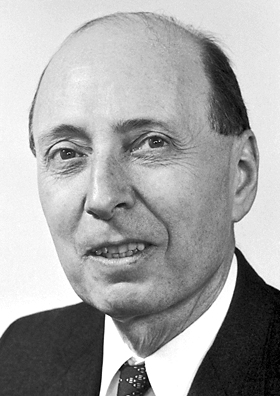

# 尤金·维格纳

**英文名：** Eugene Paul Wigner

**生卒：** 1902年11月17日 — 1995年1月1日

**主要领域：** 核物理、对称性、数学物理

肖像的作者、拍摄或创作年代及具体形式见图片来源。

## 生平简介

尤金·维格纳出生于Budapest, Austria-Hungary (now Hungary)，主要从事核物理、对称性、数学物理研究。诺贝尔奖资料所列获奖时任职机构为Princeton University。其代表成果包括将群论与基本对称性系统用于量子力学，获1963年诺贝尔物理学奖。

## 对物理的主要贡献

- 将群论与基本对称性系统用于量子力学
- 研究原子核结构及基本粒子的对称性原理

**诺贝尔物理学奖：** 1963

## 肖像来源与许可

- 来源：[Wigner.jpg](https://commons.wikimedia.org/wiki/File:Wigner.jpg)
- 作者／署名：Nobel foundation
- 许可：Public domain
- 本地文件：[567f559ea9b79077d2f0.jpg](../portraits/567f559ea9b79077d2f0.jpg)
- 原始来源说明：https://nobelprize.org/nobel_prizes/physics/laureates/1963/wigner-bio.html

## 资料来源

- [Eugene Wigner - Facts](https://www.nobelprize.org/prizes/physics/1963/wigner/facts/)
- [Nobel Prize official laureate API, id 78](https://api.nobelprize.org/2.1/laureate/78)
- [Wikipedia: Eugene Wigner](https://en.wikipedia.org/wiki/Eugene_Wigner)

资料整理日期：2026-10-26。
