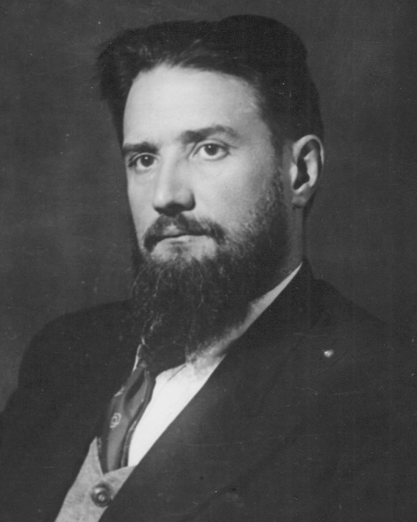

# 伊戈尔·库尔恰托夫

**英文名：** Igor Kurchatov

**生卒：** 1903年1月12日 — 1960年2月7日

**主要领域：** 核物理、核能

肖像的作者、拍摄或创作年代及具体形式见图片来源。

## 生平简介

苏联实验物理学家，早期研究电介质和原子核，二战期间起领导苏联核计划。他组织核反应堆、核武器和核能研究，在苏联核科学机构建设中发挥关键作用。

## 对物理的主要贡献

- 组织建造苏联早期核反应堆
- 领导核裂变、链式反应及核能技术研究
- 推动核电与受控聚变研究机构建设

## 史料说明

- 出生日期采用公历；部分俄文历史资料另列儒略历日期。

## 肖像来源与许可

- 来源：[Igor_Kurchatov_001.png](https://commons.wikimedia.org/wiki/File:Igor_Kurchatov_001.png)
- 作者／署名：Unknown author
- 许可：Public domain
- 本地文件：[275443d2306d4ff44c33.png](../portraits/275443d2306d4ff44c33.png)
- 原始来源说明：Журнал "Огонёк" № 3, 1948 г. https://mipt-museum.ru/о-физтехе/личности/выдающиеся-личности-к/курчатов-игорь-васильевич-2/

## 资料来源

- [Wikipedia: Igor Kurchatov](https://en.wikipedia.org/wiki/Igor_Kurchatov)

资料整理日期：2026-10-26。
