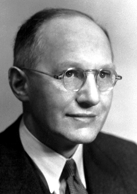

# 欧内斯特·沃尔顿

**英文名：** Ernest Thomas Sinton Walton

**生卒：** 1903年10月6日 — 1995年6月25日

**主要领域：** 核物理、加速器物理

肖像的作者、拍摄或创作年代及具体形式见图片来源。

## 生平简介

欧内斯特·沃尔顿出生于Dungarvan, Ireland，主要从事核物理、加速器物理研究。诺贝尔奖资料所列获奖时任职机构为Trinity College。其代表成果包括用人工加速的带电粒子引起原子核转变，获1951年诺贝尔物理学奖。

## 对物理的主要贡献

- 用人工加速的带电粒子引起原子核转变
- 发展早期高压粒子加速器实验

**诺贝尔物理学奖：** 1951

## 肖像来源与许可

- 来源：[Ernest_Walton.jpg](https://commons.wikimedia.org/wiki/File:Ernest_Walton.jpg)
- 作者／署名：Nobel foundation
- 许可：Public domain
- 本地文件：[c2015cc523ba5a0ecec1.jpg](../portraits/c2015cc523ba5a0ecec1.jpg)
- 原始来源说明：http://nobelprize.org/nobel_prizes/physics/laureates/1951/walton-bio.html

## 资料来源

- [Ernest T.S. Walton - Facts](https://www.nobelprize.org/prizes/physics/1951/walton/facts/)
- [Nobel Prize official laureate API, id 57](https://api.nobelprize.org/2.1/laureate/57)
- [Wikipedia: Ernest Walton](https://en.wikipedia.org/wiki/Ernest_Walton)

资料整理日期：2026-10-26。
