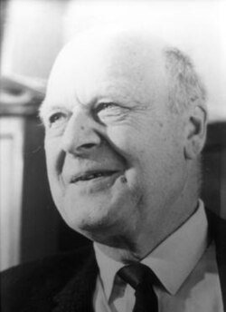

# 拉尔斯·昂萨格

**英文名：** Lars Onsager

**生卒：** 1903年11月27日 — 1976年10月5日

**主要领域：** 统计物理、热力学

已核对对应人物条目使用的历史肖像；图像文件来自英语维基百科本地文件库。

## 生平简介

挪威出生的理论物理化学家，后长期在美国耶鲁大学任教。他以数学方法研究不可逆过程与相变，因不可逆热力学的互易关系获1968年诺贝尔化学奖。

## 对物理的主要贡献

- 建立不可逆过程的昂萨格互易关系
- 给出二维正方格点伊辛模型的精确解
- 研究超流体涡旋及湍流统计

## 肖像来源与许可

- 来源：[Lars_Onsager2.jpg](https://en.wikipedia.org/wiki/File:Lars_Onsager2.jpg)
- 作者／署名：见原图页面
- 许可：非自由历史照片或版权状态未确认；公开网页使用前需核查授权
- 本地文件：[db4a0d056796d6f28ad7-6bc68b60a7.jpg](../portraits/db4a0d056796d6f28ad7-6bc68b60a7.jpg)
- 授权状态：仅记录来源与本地档案副本；未确认可用于网站再发布，发布前须向权利人核实授权。

## 资料来源

- [Wikipedia: Lars Onsager](https://en.wikipedia.org/wiki/Lars_Onsager)

资料整理日期：2026-10-26。
