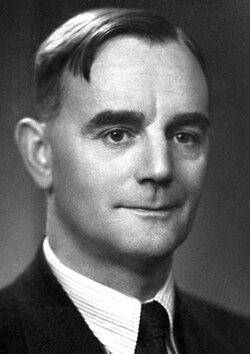

# 塞西尔·鲍威尔

**英文名：** Cecil Frank Powell

**生卒：** 1903年12月5日 — 1969年8月9日

**主要领域：** 粒子物理、探测技术

肖像的作者、拍摄或创作年代及具体形式见图片来源。

## 生平简介

塞西尔·鲍威尔出生于Tonbridge, United Kingdom，主要从事粒子物理、探测技术研究。诺贝尔奖资料所列获奖时任职机构为Bristol University。其代表成果包括发展核乳胶记录高能粒子径迹的技术，获1950年诺贝尔物理学奖。

## 对物理的主要贡献

- 发展核乳胶记录高能粒子径迹的技术
- 参与发现并研究π介子

**诺贝尔物理学奖：** 1950

## 肖像来源与许可

- 来源：[Cecil_Powell.jpg](https://commons.wikimedia.org/wiki/File:Cecil_Powell.jpg)
- 作者／署名：Nobel foundation
- 许可：Public domain
- 本地文件：[0695317bdddb7dac0a6e.jpg](../portraits/0695317bdddb7dac0a6e.jpg)
- 原始来源说明：http://nobelprize.org/nobel_prizes/physics/laureates/1950/powell-bio.html

## 资料来源

- [Cecil Powell - Facts](https://www.nobelprize.org/prizes/physics/1950/powell/facts/)
- [Nobel Prize official laureate API, id 55](https://api.nobelprize.org/2.1/laureate/55)
- [Wikipedia: C. F. Powell](https://en.wikipedia.org/wiki/C._F._Powell)

资料整理日期：2026-10-26。
