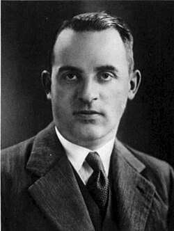

# 拉尔夫·克罗尼格

**英文名：** Ralph Kronig

**生卒：** 1904年3月10日 — 1995年11月16日

**主要领域：** 量子理论、凝聚态物理、光学

肖像的作者、拍摄或创作年代及具体形式见图片来源。

## 生平简介

出生于德累斯顿的理论物理学家，在哥伦比亚大学接受训练，后来在格罗宁根和代尔夫特工作。他研究原子光谱、晶体电子和线性响应，曾较早构想电子自旋但未据此优先发表，许多成果成为量子材料与光学的基本工具。

## 对物理的主要贡献

- 发展克拉默斯—克罗尼格色散关系，联系响应的色散与吸收部分
- 与彭尼提出周期势中的克罗尼格—彭尼电子模型
- 研究分子光谱与电子自旋问题，参与早期量子理论发展

## 肖像来源与许可

- 来源：[Prof._Dr._R._de_Laer_Kronig,_1940_(cropped).jpg](https://commons.wikimedia.org/wiki/File:Prof._Dr._R._de_Laer_Kronig,_1940_(cropped).jpg)
- 作者／署名：Unknown author
- 许可：Public domain
- 本地文件：[f170b62ef215a1dd8b00-6273c3870e.jpg](../portraits/f170b62ef215a1dd8b00-6273c3870e.jpg)
- 原始来源说明：Delftsche studenten-almanak voor het jaar ..., 1940, 1940. Geraadpleegd op Delpher op 16-11-2021, https://resolver.kb.nl/resolve?urn=MMAD01:000173001:00001

## 资料来源

- [University of Groningen: Ralph Kronig](https://www.math.rug.nl/bernoulli/Geschiedenis/Kronig)
- [H. B. G. Casimir: KNAW memorial for Ralph Kronig](https://www.math.rug.nl/bernoulli/uploads/Geschiedenis/levensberichtkronig.pdf)
- [Wikipedia: Ralph Kronig](https://en.wikipedia.org/wiki/Ralph_Kronig)

资料整理日期：2026-10-26。
