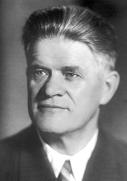

# 帕维尔·切伦科夫

**英文名：** Pavel Alekseyevich Cherenkov

**生卒：** 1904年7月28日 — 1990年1月6日

**主要领域：** 辐射物理、粒子探测

肖像的作者、拍摄或创作年代及具体形式见图片来源。

## 生平简介

帕维尔·切伦科夫出生于Novaya Chigla, Russia，主要从事辐射物理、粒子探测研究。诺贝尔奖资料所列获奖时任职机构为P.N. Lebedev Physical Institute。其代表成果包括发现带电粒子在介质中速度超过该介质光的相速度时发出的切伦科夫辐射，获1958年诺贝尔物理学奖。

## 对物理的主要贡献

- 发现带电粒子在介质中速度超过该介质光的相速度时发出的切伦科夫辐射
- 开辟利用这种辐射探测粒子的实验方法

**诺贝尔物理学奖：** 1958

## 肖像来源与许可

- 来源：[Cerenkov.jpg](https://commons.wikimedia.org/wiki/File:Cerenkov.jpg)
- 作者／署名：Nobel foundation
- 许可：Public domain
- 本地文件：[8f2034dd2d559f83117f.jpg](../portraits/8f2034dd2d559f83117f.jpg)
- 原始来源说明：http://nobelprize.org/nobel_prizes/physics/laureates/1958/cerenkov-bio.html

## 资料来源

- [Pavel A. Cherenkov - Facts](https://www.nobelprize.org/prizes/physics/1958/cerenkov/facts/)
- [Nobel Prize official laureate API, id 70](https://api.nobelprize.org/2.1/laureate/70)
- [Wikipedia: Pavel Cherenkov](https://en.wikipedia.org/wiki/Pavel_Cherenkov)

资料整理日期：2026-10-26。
