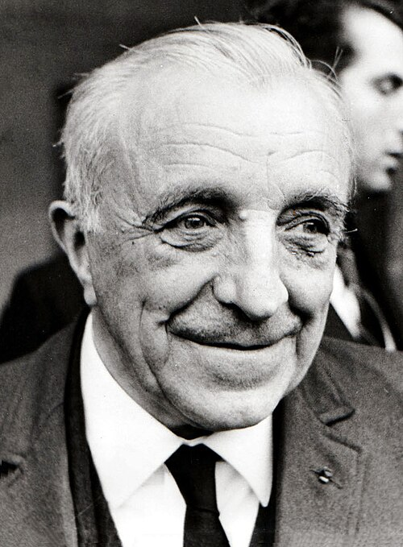

# 路易·奈尔

**英文名：** Louis Eugène Félix Néel

**生卒：** 1904年11月22日 — 2000年11月17日

**主要领域：** 凝聚态物理、磁性

肖像的作者、拍摄或创作年代及具体形式见图片来源。

## 生平简介

路易·奈尔出生于Lyon, France，主要从事凝聚态物理、磁性研究。诺贝尔奖资料所列获奖时任职机构为University of Grenoble。其代表成果包括提出反铁磁性和亚铁磁性的理论，获1970年诺贝尔物理学奖。

## 对物理的主要贡献

- 提出反铁磁性和亚铁磁性的理论
- 解释不同磁性子晶格形成的宏观磁学行为

**诺贝尔物理学奖：** 1970

## 肖像来源与许可

- 来源：[Louis_Néel_1970b.jpg](https://commons.wikimedia.org/wiki/File:Louis_N%C3%A9el_1970b.jpg)
- 作者／署名：Farabola
- 许可：Public domain
- 本地文件：[bf011fdd556e790fb4db.jpg](../portraits/bf011fdd556e790fb4db.jpg)
- 原始来源说明：[1]

## 资料来源

- [Louis Néel - Facts](https://www.nobelprize.org/prizes/physics/1970/neel/facts/)
- [Nobel Prize official laureate API, id 92](https://api.nobelprize.org/2.1/laureate/92)
- [Wikipedia: Louis Néel](https://en.wikipedia.org/wiki/Louis_N%C3%A9el)

资料整理日期：2026-10-26。
