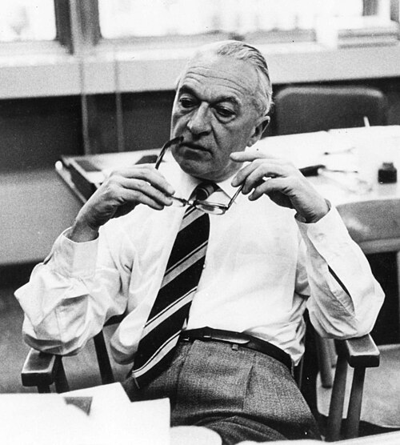

# 布鲁诺·罗西

**英文名：** Bruno Rossi

**生卒：** 1905年4月13日 — 1993年11月21日

**主要领域：** 宇宙线、天体物理

肖像的作者、拍摄或创作年代及具体形式见图片来源。

## 生平简介

意大利实验物理学家，因法西斯种族法离开意大利，后在美国麻省理工学院工作。他将电子学用于宇宙线探测，并推动空间时代的X射线天文学研究。

## 对物理的主要贡献

- 发展快速电子符合电路以测量宇宙线
- 研究宇宙线广延空气簇射与介子寿命
- 推动早期宇宙X射线探测实验

## 肖像来源与许可

- 来源：[Bruno_B_Rossi.jpg](https://commons.wikimedia.org/wiki/File:Bruno_B_Rossi.jpg)
- 作者／署名：Massachusetts Institute of Technology
- 许可：[CC BY-SA 3.0](https://creativecommons.org/licenses/by-sa/3.0)
- 本地文件：[6f86e993cbfe9c656900.jpg](../portraits/6f86e993cbfe9c656900.jpg)
- 原始来源说明：Wikipedia:Contact us/Photo submission

## 资料来源

- [Wikipedia: Bruno Rossi](https://en.wikipedia.org/wiki/Bruno_Rossi)

资料整理日期：2026-10-26。
