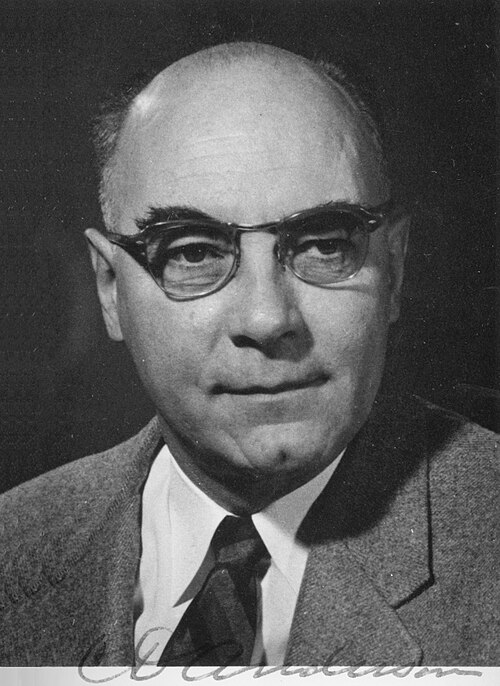

# 卡尔·戴维·安德森

**英文名：** Carl David Anderson

**生卒：** 1905年9月3日 — 1991年1月11日

**主要领域：** 粒子物理、宇宙线

肖像的作者、拍摄或创作年代及具体形式见图片来源。

## 生平简介

卡尔·戴维·安德森出生于New York, NY, USA，主要从事粒子物理、宇宙线研究。诺贝尔奖资料所列获奖时任职机构为California Institute of Technology (Caltech)。其代表成果包括在宇宙线云室径迹中发现正电子，获1936年诺贝尔物理学奖。

## 对物理的主要贡献

- 在宇宙线云室径迹中发现正电子
- 参与发现后来被称为μ子的粒子

**诺贝尔物理学奖：** 1936

## 肖像来源与许可

- 来源：[Carl_David_Anderson.jpg](https://commons.wikimedia.org/wiki/File:Carl_David_Anderson.jpg)
- 作者／署名：Smithsonian Institution
- 许可：[No restrictions](https://www.flickr.com/commons/usage/)
- 本地文件：[4cfcdcd02818f4573b05.jpg](../portraits/4cfcdcd02818f4573b05.jpg)
- 原始来源说明：originally posted to Flickr as Portrait of Carl David Anderson (1905-1991), Physicist

## 资料来源

- [Carl D. Anderson - Facts](https://www.nobelprize.org/prizes/physics/1936/anderson/facts/)
- [Nobel Prize official laureate API, id 43](https://api.nobelprize.org/2.1/laureate/43)
- [Wikipedia: Carl David Anderson](https://en.wikipedia.org/wiki/Carl_David_Anderson)

资料整理日期：2026-10-26。
