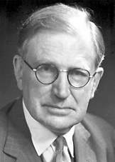

# 内维尔·莫特

**英文名：** Sir Nevill Francis Mott

**生卒：** 1905年9月30日 — 1996年8月8日

**主要领域：** 凝聚态物理、电子关联

肖像的作者、拍摄或创作年代及具体形式见图片来源。

## 生平简介

内维尔·莫特出生于Leeds, United Kingdom，主要从事凝聚态物理、电子关联研究。诺贝尔奖资料所列获奖时任职机构为University of Cambridge。其代表成果包括研究电子关联对金属绝缘体转变的作用，获1977年诺贝尔物理学奖。

## 对物理的主要贡献

- 研究电子关联对金属绝缘体转变的作用
- 发展非晶态及无序固体的电子理论

**诺贝尔物理学奖：** 1977

## 肖像来源与许可

- 来源：[Mott,Nevill Francis 1952 London.jpg](https://commons.wikimedia.org/wiki/File:Mott,Nevill_Francis_1952_London.jpg)
- 作者／署名：Friedrich Hund / Gerhard Hund (GFHund)
- 许可：[CC BY 3.0](https://creativecommons.org/licenses/by/3.0)
- 本地文件：[5bc53d1c7de26489e340-a39e4cf6a6.jpg](../portraits/5bc53d1c7de26489e340-a39e4cf6a6.jpg)
- 原始来源说明：Own work

## 资料来源

- [Sir Nevill F. Mott - Facts](https://www.nobelprize.org/prizes/physics/1977/mott/facts/)
- [Nobel Prize official laureate API, id 108](https://api.nobelprize.org/2.1/laureate/108)
- [Wikipedia: Nevill Francis Mott](https://en.wikipedia.org/wiki/Nevill_Francis_Mott)

资料整理日期：2026-10-26。
