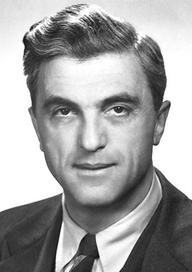

# 费利克斯·布洛赫

**英文名：** Felix Bloch

**生卒：** 1905年10月23日 — 1983年9月10日

**主要领域：** 核磁共振、原子物理

肖像的作者、拍摄或创作年代及具体形式见图片来源。

## 生平简介

费利克斯·布洛赫出生于Zurich, Switzerland，主要从事核磁共振、原子物理研究。诺贝尔奖资料所列获奖时任职机构为Stanford University。其代表成果包括分别发展探测宏观样品核磁共振的方法，获1952年诺贝尔物理学奖。

## 对物理的主要贡献

- 分别发展探测宏观样品核磁共振的方法
- 为凝聚态研究及后来的磁共振技术提供实验基础

**诺贝尔物理学奖：** 1952

## 肖像来源与许可

- 来源：[Bloch.jpg](https://commons.wikimedia.org/wiki/File:Bloch.jpg)
- 作者／署名：Unknown author
- 许可：Public domain
- 本地文件：[84b4eb121e014f0d1245.jpg](../portraits/84b4eb121e014f0d1245.jpg)
- 原始来源说明：http://nobelprize.org/nobel_prizes/physics/laureates/1952/bloch-bio.html

## 资料来源

- [Felix Bloch - Facts](https://www.nobelprize.org/prizes/physics/1952/bloch/facts/)
- [Nobel Prize official laureate API, id 58](https://api.nobelprize.org/2.1/laureate/58)
- [Wikipedia: Felix Bloch](https://en.wikipedia.org/wiki/Felix_Bloch)

资料整理日期：2026-10-26。
