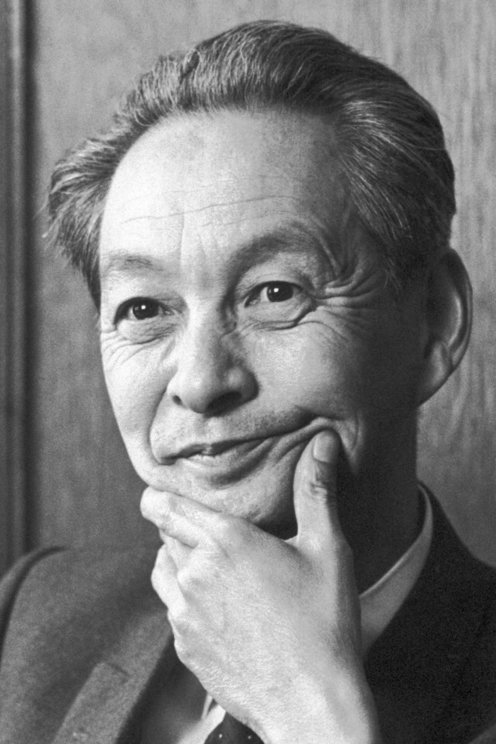

# 朝永振一郎

**英文名：** Sin-Itiro Tomonaga

**生卒：** 1906年3月31日 — 1979年7月8日

**主要领域：** 量子电动力学、粒子物理

肖像的作者、拍摄或创作年代及具体形式见图片来源。

## 生平简介

朝永振一郎出生于Kyoto, Japan，主要从事量子电动力学、粒子物理研究。诺贝尔奖资料所列获奖时任职机构为Tokyo University of Education。其代表成果包括发展经过重整化的量子电动力学，获1965年诺贝尔物理学奖。

## 对物理的主要贡献

- 发展经过重整化的量子电动力学
- 使电子与电磁场相互作用的可测量结果能够得到高精度计算

**诺贝尔物理学奖：** 1965

## 肖像来源与许可

- 来源：[Tomonaga.jpg](https://commons.wikimedia.org/wiki/File:Tomonaga.jpg)
- 作者／署名：Nobel foundation
- 许可：Public domain
- 本地文件：[5d7d60bafe5abcbd61e7.jpg](../portraits/5d7d60bafe5abcbd61e7.jpg)
- 原始来源说明：https://www.nobelprize.org/prizes/physics/1965/tomonaga/facts/

## 资料来源

- [Sin-Itiro Tomonaga - Facts](https://www.nobelprize.org/prizes/physics/1965/tomonaga/facts/)
- [Nobel Prize official laureate API, id 84](https://api.nobelprize.org/2.1/laureate/84)
- [Wikipedia: Sin-Itiro Tomonaga](https://en.wikipedia.org/wiki/Sin-Itiro_Tomonaga)

资料整理日期：2026-10-26。
