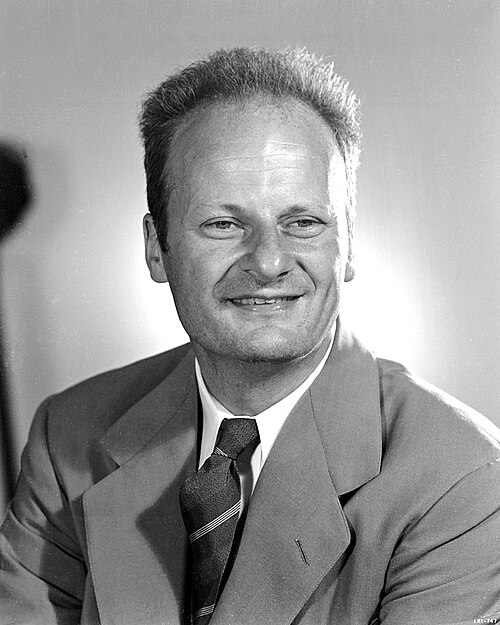

# 汉斯·贝特

**英文名：** Hans Albrecht Bethe

**生卒：** 1906年7月2日 — 2005年3月6日

**主要领域：** 核天体物理、核物理

肖像的作者、拍摄或创作年代及具体形式见图片来源。

## 生平简介

汉斯·贝特出生于Strasbourg, Germany (now France)，主要从事核天体物理、核物理研究。诺贝尔奖资料所列获奖时任职机构为Cornell University。其代表成果包括阐明恒星中的核反应及能量产生机制，获1967年诺贝尔物理学奖。

## 对物理的主要贡献

- 阐明恒星中的核反应及能量产生机制
- 研究质子质子链和碳氮氧循环等恒星能源过程

**诺贝尔物理学奖：** 1967

## 肖像来源与许可

- 来源：[Hans_Bethe.jpg](https://commons.wikimedia.org/wiki/File:Hans_Bethe.jpg)
- 作者／署名：Los Alamos National Laboratory
- 许可：Attribution
- 本地文件：[dfeb9d41e69e6d9ac404.jpg](../portraits/dfeb9d41e69e6d9ac404.jpg)
- 原始来源说明：Los Alamos National Laboratory

## 资料来源

- [Hans Bethe - Facts](https://www.nobelprize.org/prizes/physics/1967/bethe/facts/)
- [Nobel Prize official laureate API, id 88](https://api.nobelprize.org/2.1/laureate/88)
- [Wikipedia: Hans Bethe](https://en.wikipedia.org/wiki/Hans_Bethe)

资料整理日期：2026-10-26。
