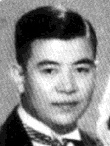

# 吴大猷

**英文名：** Wu Ta-You

**生卒：** 1907年 — 2000年3月4日

**主要领域：** 原子分子物理、理论物理

从1936年吴大猷与夫人合照中裁取的吴大猷头像；原图仅110×146像素。

## 生平简介

出生于广东的理论物理学家，在密歇根大学取得博士学位后曾任教于北京大学及西南联合大学，后在加拿大、美国和台湾工作。他研究分子光谱，培养了杨振宁、李政道等学生。

## 对物理的主要贡献

- 研究多原子分子振动光谱与结构
- 发展理论物理和量子散射的教学著述
- 推动近代物理人才培养与科研机构建设

## 史料说明

- 资料中的生日涉及公历与旧历混用，并有9月27日、9月29日、11月4日等不同记载；本档案暂保留共同确认的1907年，不假定月日。

## 肖像来源与许可

- 来源：[吳大猷與夫人 (cropped).jpg](https://commons.wikimedia.org/wiki/File:%E5%90%B3%E5%A4%A7%E7%8C%B7%E8%88%87%E5%A4%AB%E4%BA%BA_%28cropped%29.jpg)
- 作者／署名：不详
- 许可：Public domain — Commons source tag (PD-China or PD-scan)
- 本地文件：[314f0b1e1bdfa5b1ef40-370813a803.jpg](../portraits/314f0b1e1bdfa5b1ef40-370813a803.jpg)
- 原始来源说明：《中國物理學之父吳大猷》所收1936年照片；Wikimedia Commons裁切版本

## 资料来源

- [中央研究院吴大猷基金会：吴大猷行述](https://www.phys.sinica.edu.tw/~tywufund/introduction.html)
- [Wikipedia: Wu Ta-You](https://en.wikipedia.org/wiki/Wu_Ta-You)

资料整理日期：2026-10-26。
