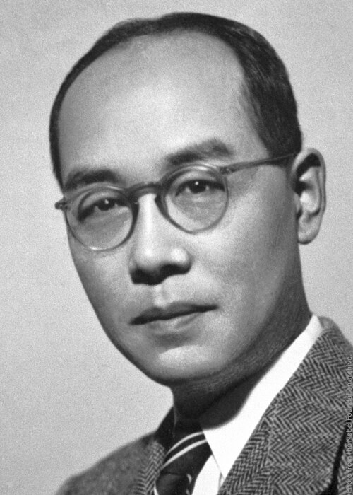

# 汤川秀树

**英文名：** Hideki Yukawa

**生卒：** 1907年1月23日 — 1981年9月8日

**主要领域：** 粒子物理、核力理论

肖像的作者、拍摄或创作年代及具体形式见图片来源。

## 生平简介

汤川秀树出生于Tokyo, Japan，主要从事粒子物理、核力理论研究。诺贝尔奖资料所列获奖时任职机构为Columbia University、Kyoto University。其代表成果包括提出以介子交换解释原子核内核子之间的作用力，获1949年诺贝尔物理学奖。

## 对物理的主要贡献

- 提出以介子交换解释原子核内核子之间的作用力
- 预言与核力传播有关的新粒子

**诺贝尔物理学奖：** 1949

## 肖像来源与许可

- 来源：[Yukawa.jpg](https://commons.wikimedia.org/wiki/File:Yukawa.jpg)
- 作者／署名：Nobel Foundation archive
- 许可：Public domain
- 本地文件：[347563d7909fd666a889.jpg](../portraits/347563d7909fd666a889.jpg)
- 原始来源说明：nobelprize.org

## 资料来源

- [Hideki Yukawa - Facts](https://www.nobelprize.org/prizes/physics/1949/yukawa/facts/)
- [Nobel Prize official laureate API, id 54](https://api.nobelprize.org/2.1/laureate/54)
- [Wikipedia: Hideki Yukawa](https://en.wikipedia.org/wiki/Hideki_Yukawa)

资料整理日期：2026-10-26。
