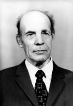

# 康斯坦丁·彼得扎克

**英文名：** Konstantin Petrzhak

**生卒：** 1907年9月4日 — 1998年

**主要领域：** 核物理、实验物理

肖像的作者、拍摄或创作年代及具体形式见图片来源。

## 生平简介

波兰裔苏联实验核物理学家，毕业于列宁格勒大学，长期在镭研究所工作。他与格奥尔基·弗廖罗夫共同发现铀的自发裂变，后来研究中子物理、裂变与放射性测量，并培养核科学人才。

## 对物理的主要贡献

- 与弗廖罗夫于1940年发现铀核的自发裂变，并通过地下实验排查宇宙线影响
- 开展中子引起的裂变截面与重核裂变性质的精密测量
- 发展放射性及中子测量方法，建立裂变和中子物理研究团队

## 史料说明

- 逝世日期存在分歧：通常记为1998年10月10日，俄罗斯原子能历史门户则记为1998年11月19日。尚未取得足以消除分歧的同时代原始记录，本档案保留到年份。

## 肖像来源与许可

- 来源：[final-nuclear-konstantin-petrzhak.jpg](https://en.wikipedia.org/wiki/File:Konstantin_Petrzhak.jpg)
- 作者／署名：见原图页面
- 许可：Non-free historical photograph hosted by English Wikipedia under its fair-use rationale; that rationale does not grant a reusable image licence. Permission must be confirmed before website publication.
- 本地文件：[c1d4fcbac470ddb87dfb-cb55539018.jpg](../portraits/c1d4fcbac470ddb87dfb-cb55539018.jpg)
- 原始来源说明：Historical photograph identified in the article as from the Radium Institute archive, reproduced on English Wikipedia; photographer unknown
- 授权状态：仅记录来源与本地档案副本；未确认可用于网站再发布，发布前须向权利人核实授权。

## 资料来源

- [Rosatom history portal — Konstantin Petrzhak](https://www.biblioatom.ru/persons/petrzhak_konstantin_antonovich/)
- [Saint Petersburg State Institute of Technology — 110th anniversary](https://spbti.ru/public/userfiles/files/75/technolog/Tehnolog_sentyabr_2017.pdf)
- [JINR — history of spontaneous fission](https://uc.jinr.ru/images/pdf/ISP/PresentationsLecturers/2022Egypt/FLNR.pdf)
- [Physical Review — Spontaneous Fission of Uranium (1940)](https://doi.org/10.1103/PhysRev.58.89.2)
- [Konstantin Petrzhak — reference biography](https://en.wikipedia.org/wiki/Konstantin_Petrzhak)

资料整理日期：2026-10-26。
