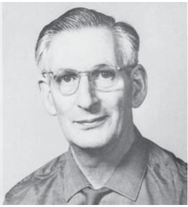

# 海因茨·伦敦

**英文名：** Heinz London

**生卒：** 1907年11月7日 — 1970年8月3日

**主要领域：** 低温物理、超导

从Cold Facts 2022年8月第27页的Heinz London专文中忠实渲染肖像区域，以保留PDF色彩空间的正确显示。

## 生平简介

德国出生的低温物理学家，因纳粹迫害移居英国，曾在牛津等机构工作。他既参与超导理论建设，也重视低温实验技术，为进一步降低实验温度提供了方法。

## 对物理的主要贡献

- 与弗里茨·伦敦提出描述超导电磁性质的伦敦方程
- 发展低温实验技术
- 提出利用氦同位素混合实现稀释制冷的思路

## 肖像来源与许可

- 来源：[heinz-london.png](https://cryo.memberclicks.net/assets/cold_facts_issues/cold_facts_vol38_no4_2022.pdf)
- 作者／署名：见原图页面
- 许可：版权所有或再发布授权未确认；公开网页使用前须核查授权
- 本地文件：[454ca624b21cb643b2a7-a68136893b.png](../portraits/454ca624b21cb643b2a7-a68136893b.png)
- 授权状态：仅记录来源与本地档案副本；未确认可用于网站再发布，发布前须向权利人核实授权。

## 资料来源

- [美国物理联合会：Heinz London papers](https://history.aip.org/history/catalog/icos/641.html)
- [Wikipedia: Heinz London](https://en.wikipedia.org/wiki/Heinz_London)

资料整理日期：2026-10-26。
