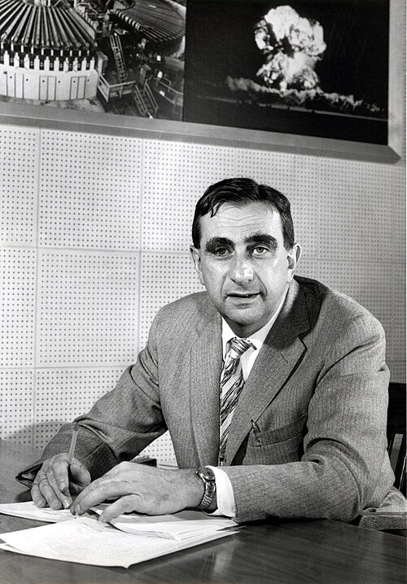

# 爱德华·泰勒

**英文名：** Edward Teller

**生卒：** 1908年1月15日 — 2003年9月9日

**主要领域：** 核物理、分子物理

肖像的作者、拍摄或创作年代及具体形式见图片来源。

## 生平简介

匈牙利出生的美国理论物理学家，在德国学习后因纳粹统治离开欧洲，1935年赴美国。他研究分子量子理论和核物理，参与曼哈顿计划、热核武器研究及利弗莫尔实验室的建立，也深度介入核政策争论。

## 对物理的主要贡献

- 与伽莫夫发展β衰变理论中的伽莫夫–泰勒跃迁
- 与赫尔曼·雅恩提出雅恩–泰勒效应，解释某些简并电子态引发的结构畸变
- 参与核与热核研究，并推动建立劳伦斯利弗莫尔实验室

## 肖像来源与许可

- 来源：[EdwardTeller1958_fewer_smudges.jpg](https://commons.wikimedia.org/wiki/File:EdwardTeller1958_fewer_smudges.jpg)
- 作者／署名：Lawrence Livermore National Laboratory, restored by w:User:Greg L, Papa Lima Whiskey
- 许可：[CC BY-SA 3.0](https://creativecommons.org/licenses/by-sa/3.0)
- 本地文件：[6f31b28c303b274257c0-2df8490276.jpg](../portraits/6f31b28c303b274257c0-2df8490276.jpg)
- 原始来源说明：EdwardTeller1958.jpg

## 资料来源

- [National Academy of Sciences — Edward Teller](https://www.nasonline.org/directory-entry/edward-teller-lhwv5g/)
- [Freeman Dyson — Edward Teller, NAS Biographical Memoir](https://www.nasonline.org/wp-content/uploads/2024/06/teller-edward.pdf)
- [Lawrence Livermore National Laboratory — Edward Teller obituary](https://www.llnl.gov/article/29486/director-emeritus-edward-teller-distinguished-physicist-and-education-advocate-dies-95)
- [Edward Teller — reference biography](https://en.wikipedia.org/wiki/Edward_Teller)

资料整理日期：2026-10-26。
