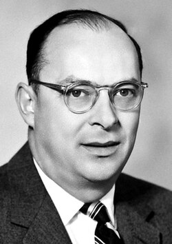

# 约翰·巴丁

**英文名：** John Bardeen

**生卒：** 1908年5月23日 — 1991年1月30日

**主要领域：** 半导体物理、超导

肖像的作者、拍摄或创作年代及具体形式见图片来源。

## 生平简介

约翰·巴丁出生于Madison, WI, USA，主要从事半导体物理、超导研究。诺贝尔奖资料所列获奖时任职机构为University of Illinois。其代表成果包括与布拉顿和肖克利共同完成晶体管相关开创性研究，获1956年、1972年诺贝尔物理学奖。

## 对物理的主要贡献

- 与布拉顿和肖克利共同完成晶体管相关开创性研究
- 与库珀和施里弗共同建立常规超导的BCS微观理论

**诺贝尔物理学奖：** 1956、1972

## 肖像来源与许可

- 来源：[Bardeen.jpg](https://commons.wikimedia.org/wiki/File:Bardeen.jpg)
- 作者／署名：Nobel foundation
- 许可：Public domain
- 本地文件：[06f39e76dc5807844842.jpg](../portraits/06f39e76dc5807844842.jpg)
- 原始来源说明：http://nobelprize.org/nobel_prizes/physics/laureates/1956/bardeen-bio.html

## 资料来源

- [John Bardeen - Facts](https://www.nobelprize.org/prizes/physics/1956/bardeen/facts/)
- [John Bardeen - Facts](https://www.nobelprize.org/prizes/physics/1972/bardeen/facts/)
- [Nobel Prize official laureate API, id 66](https://api.nobelprize.org/2.1/laureate/66)
- [Wikipedia: John Bardeen](https://en.wikipedia.org/wiki/John_Bardeen)

资料整理日期：2026-10-26。
