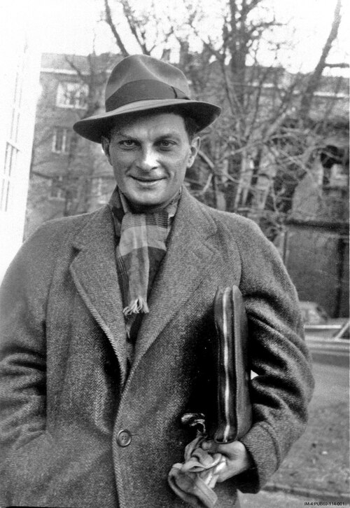

# 斯坦尼斯瓦夫·乌拉姆

**英文名：** Stanislaw Ulam

**生卒：** 1909年4月13日 — 1984年5月13日

**主要领域：** 计算物理、数学物理

肖像的作者、拍摄或创作年代及具体形式见图片来源。

## 生平简介

波兰出生的数学家，二战前赴美国，后长期在洛斯阿拉莫斯工作。他把概率、计算和动力系统思想用于复杂物理问题，对科学计算及核研究产生重要影响。

## 对物理的主要贡献

- 与冯·诺伊曼等推动蒙特卡洛计算方法
- 参与费米—帕斯塔—乌拉姆非线性振子数值实验
- 研究核反应与热核装置的理论问题

## 肖像来源与许可

- 来源：[Stanislaw_Ulam.tif](https://commons.wikimedia.org/wiki/File:Stanislaw_Ulam.tif)
- 作者／署名：Los Alamos National Laboratory
- 许可：Attribution
- 本地文件：[6f64637a7deab755db8e.jpg](../portraits/6f64637a7deab755db8e.jpg)
- 原始来源说明：Los Alamos National Laboratory archive

## 资料来源

- [Wikipedia: Stanislaw Ulam](https://en.wikipedia.org/wiki/Stanislaw_Ulam)

资料整理日期：2026-10-26。
