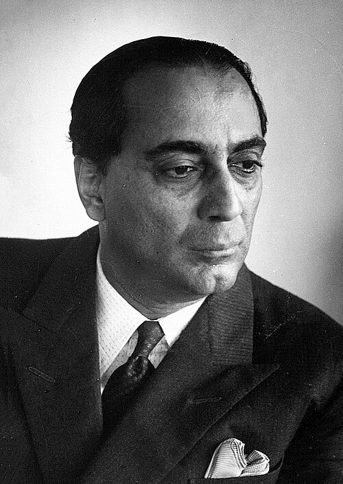

# 霍米·贾汉吉尔·巴巴

**英文名：** Homi J. Bhabha

**生卒：** 1909年10月30日 — 1966年1月24日

**主要领域：** 粒子物理、宇宙线

肖像的作者、拍摄或创作年代及具体形式见图片来源。

## 生平简介

印度理论物理学家，曾在剑桥大学研究，后回到印度创建塔塔基础研究所并组织原子能研究。他在宇宙线与量子电动力学中作出贡献，也推动印度基础科学机构建设。

## 对物理的主要贡献

- 计算正负电子散射的巴巴散射过程
- 与海特勒发展宇宙线电磁级联理论
- 组织印度核科学和高能物理研究体系

## 肖像来源与许可

- 来源：[Homi_Jehangir_Bhabha_1960s.jpg](https://commons.wikimedia.org/wiki/File:Homi_Jehangir_Bhabha_1960s.jpg)
- 作者／署名：Unknown (Mondadori Publishers)
- 许可：Public domain
- 本地文件：[5a7ce171e85a061b55c3.jpg](../portraits/5a7ce171e85a061b55c3.jpg)
- 原始来源说明：http://www.gettyimages.co.uk/detail/news-photo/portrait-of-a-nuclear-physicist-homi-bhabha-1960s-news-photo/141551109

## 资料来源

- [Wikipedia: Homi J. Bhabha](https://en.wikipedia.org/wiki/Homi_J._Bhabha)

资料整理日期：2026-10-26。
