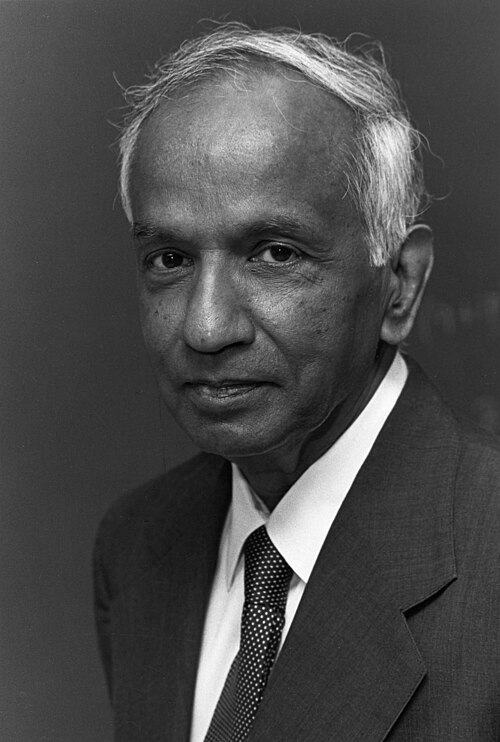

# 苏布拉马尼扬·钱德拉塞卡

**英文名：** Subrahmanyan Chandrasekhar

**生卒：** 1910年10月19日 — 1995年8月21日

**主要领域：** 天体物理、恒星结构

肖像的作者、拍摄或创作年代及具体形式见图片来源。

## 生平简介

苏布拉马尼扬·钱德拉塞卡出生于Lahore, India (now Pakistan)，主要从事天体物理、恒星结构研究。诺贝尔奖资料所列获奖时任职机构为University of Chicago。其代表成果包括建立白矮星质量极限理论，获1983年诺贝尔物理学奖。

## 对物理的主要贡献

- 建立白矮星质量极限理论
- 系统研究恒星结构、动力学和致密天体演化

**诺贝尔物理学奖：** 1983

## 肖像来源与许可

- 来源：[Subrahmanyan_Chandrasekhar.jpg](https://commons.wikimedia.org/wiki/File:Subrahmanyan_Chandrasekhar.jpg)
- 作者／署名：AIP Emilio Segrè Visual Archives, Gift of Kameshwar Wali
- 许可：Attribution
- 本地文件：[085eff4db5e357900fdb.jpg](../portraits/085eff4db5e357900fdb.jpg)
- 原始来源说明：https://repository.aip.org/portrait-chandrasekhar

## 资料来源

- [Subrahmanyan Chandrasekhar - Facts](https://www.nobelprize.org/prizes/physics/1983/chandrasekhar/facts/)
- [Nobel Prize official laureate API, id 122](https://api.nobelprize.org/2.1/laureate/122)
- [Wikipedia: Subrahmanyan Chandrasekhar](https://en.wikipedia.org/wiki/Subrahmanyan_Chandrasekhar)

资料整理日期：2026-10-26。
