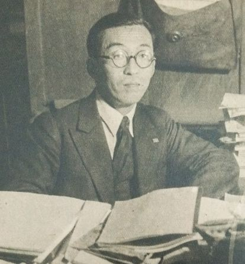

# 坂田昌一

**英文名：** Shoichi Sakata

**生卒：** 1911年1月18日 — 1970年10月16日

**主要领域：** 粒子物理

肖像的作者、拍摄或创作年代及具体形式见图片来源。

## 生平简介

日本理论物理学家，长期在名古屋大学任教。他重视从实验规律建立粒子结构模型，与同事培养了日本战后粒子理论研究群体，其思想影响夸克模型及中微子混合研究。

## 对物理的主要贡献

- 提出以质子、中子和Λ粒子为基本组成的坂田模型
- 参与提出中性介子与粒子分类理论
- 与牧二郎、中川昌美提出早期轻子混合框架

## 肖像来源与许可

- 来源：[Sakata_Shoichi.JPG](https://commons.wikimedia.org/wiki/File:Sakata_Shoichi.JPG)
- 作者／署名：朝日新聞社
- 许可：Public domain
- 本地文件：[27b4af328db4fc76647d.jpg](../portraits/27b4af328db4fc76647d.jpg)
- 原始来源说明：『アサヒグラフ』 1949年5月4日号

## 资料来源

- [日本国立国会图书馆典据：坂田昌一](https://id.ndl.go.jp/auth/ndlna/00066387)
- [Wikipedia: Shoichi Sakata](https://en.wikipedia.org/wiki/Shoichi_Sakata)

资料整理日期：2026-10-26。
