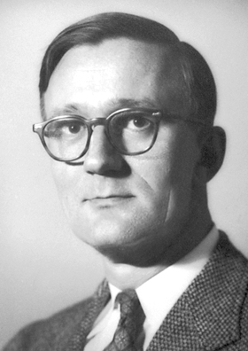

# 波利卡普·库施

**英文名：** Polykarp Kusch

**生卒：** 1911年1月26日 — 1993年3月20日

**主要领域：** 原子物理、精密测量

肖像的作者、拍摄或创作年代及具体形式见图片来源。

## 生平简介

波利卡普·库施出生于Blankenburg, Germany，主要从事原子物理、精密测量研究。诺贝尔奖资料所列获奖时任职机构为Columbia University。其代表成果包括精密测量电子磁矩并揭示其偏离简单狄拉克理论值的微小差异，获1955年诺贝尔物理学奖。

## 对物理的主要贡献

- 精密测量电子磁矩并揭示其偏离简单狄拉克理论值的微小差异
- 为电子反常磁矩与量子电动力学研究提供实验依据

**诺贝尔物理学奖：** 1955

## 肖像来源与许可

- 来源：[Polykarp_Kusch.jpg](https://commons.wikimedia.org/wiki/File:Polykarp_Kusch.jpg)
- 作者／署名：Nobel foundation
- 许可：Public domain
- 本地文件：[6daa94dabe5113f1f3d4.jpg](../portraits/6daa94dabe5113f1f3d4.jpg)
- 原始来源说明：http://nobelprize.org/nobel_prizes/physics/laureates/1955/kusch-bio.html

## 资料来源

- [Polykarp Kusch - Facts](https://www.nobelprize.org/prizes/physics/1955/kusch/facts/)
- [Nobel Prize official laureate API, id 64](https://api.nobelprize.org/2.1/laureate/64)
- [Wikipedia: Polykarp Kusch](https://en.wikipedia.org/wiki/Polykarp_Kusch)

资料整理日期：2026-10-26。
