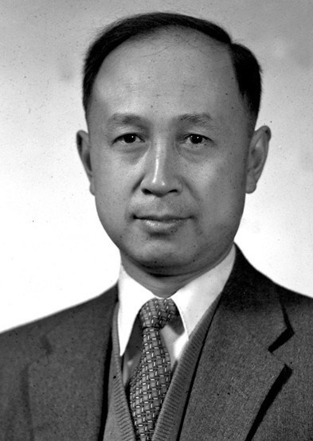

# 钱学森

**英文名：** Qian Xuesen

**生卒：** 1911年12月11日 — 2009年10月31日

**主要领域：** 空气动力学、工程控制

肖像的作者、拍摄或创作年代及具体形式见图片来源。

## 生平简介

出生于上海的力学家和工程科学家，曾在麻省理工学院与加州理工学院学习研究，师从冯·卡门。1955年回国后参与中国航天事业建设，也以系统方法研究工程问题。

## 对物理的主要贡献

- 研究高速空气动力学、可压缩流动和火箭飞行理论
- 建立工程控制论的系统表述
- 推动中国火箭、导弹与空间技术的理论及工程组织

## 肖像来源与许可

- 来源：[歸國後的錢學森.png](https://commons.wikimedia.org/wiki/File:%E6%AD%B8%E5%9C%8B%E5%BE%8C%E7%9A%84%E9%8C%A2%E5%AD%B8%E6%A3%AE.png)
- 作者／署名：Unknown author
- 许可：Public domain
- 本地文件：[8df38bf84640cb4efe60.png](../portraits/8df38bf84640cb4efe60.png)
- 原始来源说明：https://glory.ucas.ac.cn/index.php?option=com_content&view=article&id=867:2016-06-29-15-58-22&catid=37&Itemid=211

## 资料来源

- [Wikipedia: Qian Xuesen](https://en.wikipedia.org/wiki/Qian_Xuesen)

资料整理日期：2026-10-26。
