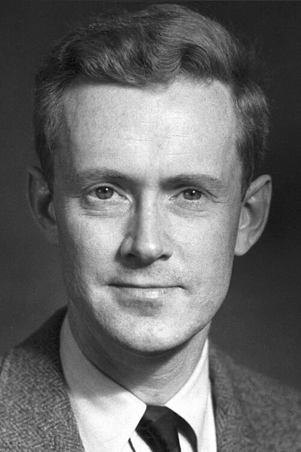

# 爱德华·珀塞尔

**英文名：** Edward Mills Purcell

**生卒：** 1912年8月30日 — 1997年3月7日

**主要领域：** 核磁共振、原子物理

肖像的作者、拍摄或创作年代及具体形式见图片来源。

## 生平简介

爱德华·珀塞尔出生于Taylorville, IL, USA，主要从事核磁共振、原子物理研究。诺贝尔奖资料所列获奖时任职机构为Harvard University。其代表成果包括分别发展探测宏观样品核磁共振的方法，获1952年诺贝尔物理学奖。

## 对物理的主要贡献

- 分别发展探测宏观样品核磁共振的方法
- 为凝聚态研究及后来的磁共振技术提供实验基础

**诺贝尔物理学奖：** 1952

## 肖像来源与许可

- 来源：[Edward_Mills_Purcell.jpg](https://commons.wikimedia.org/wiki/File:Edward_Mills_Purcell.jpg)
- 作者／署名：Unknown author
- 许可：Public domain
- 本地文件：[5c5f16e56cc4d7920b3e.jpg](../portraits/5c5f16e56cc4d7920b3e.jpg)
- 原始来源说明：http://nobelprize.org/nobel_prizes/physics/laureates/1952/purcell-bio.html

## 资料来源

- [E. M. Purcell - Facts](https://www.nobelprize.org/prizes/physics/1952/purcell/facts/)
- [Nobel Prize official laureate API, id 59](https://api.nobelprize.org/2.1/laureate/59)
- [Wikipedia: Edward Mills Purcell](https://en.wikipedia.org/wiki/Edward_Mills_Purcell)

资料整理日期：2026-10-26。
