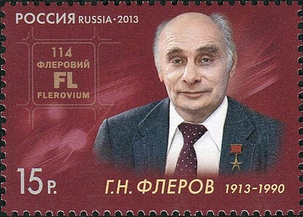

# 格奥尔基·弗廖罗夫

**英文名：** Georgy Flerov

**生卒：** 1913年3月2日 — 1990年11月19日

**主要领域：** 核物理、实验物理

2013年俄罗斯发行的弗廖罗夫诞辰百年纪念邮票；这是逝世后创作的纪念性形象。保留完整邮票，不将头像部分单独裁切使用。

## 生平简介

苏联实验核物理学家，早年在列宁格勒研究核反应，后参与苏联核计划。他是杜布纳联合核研究所的创始科学家之一，长期领导核反应实验室，推动重离子与超重元素研究。

## 对物理的主要贡献

- 与彼得扎克于1940年发现铀核的自发裂变
- 发展重离子核反应实验，研究重元素及原子核稳定性
- 创建并领导杜布纳核反应实验室，组织超重元素研究

## 史料说明

- 生日采用公历1913年3月2日，对应当时俄历（儒略历）2月17日；英文也常将其姓拼作Flyorov。

## 肖像来源与许可

- 来源：[RUSMARKA-1660.jpg](https://commons.wikimedia.org/wiki/File:RUSMARKA-1660.jpg)
- 作者／署名：Stamp issuing authority - MARKA Publishing & Trading Centre. Printer - Association GOZNAK of the Ministry of Finance of the Russian Federation
- 许可：Public domain
- 本地文件：[4c0a77ce20dc77e78caa-06f42ab705.jpg](../portraits/4c0a77ce20dc77e78caa-06f42ab705.jpg)
- 原始来源说明：[1]

## 资料来源

- [JINR — Remembering the founders](https://www.jinr.ru/posts/vspominaya-osnovatelej-03_21/)
- [Russian Academy of Sciences — Georgy Flerov](https://new.ras.ru/academy-new/staff/akademiki/flerov-georgiy-nikolaevich/)
- [Physical Review — Spontaneous Fission of Uranium (1940)](https://doi.org/10.1103/PhysRev.58.89.2)
- [Georgy Flerov — reference biography](https://en.wikipedia.org/wiki/Georgy_Flerov)

资料整理日期：2026-10-26。
