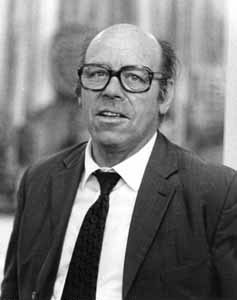

# 沃尔夫冈·保罗

**英文名：** Wolfgang Paul

**生卒：** 1913年8月10日 — 1993年12月7日

**主要领域：** 原子物理、离子阱

肖像的作者、拍摄或创作年代及具体形式见图片来源。

## 生平简介

沃尔夫冈·保罗出生于Lorenzkirch, Germany，主要从事原子物理、离子阱研究。诺贝尔奖资料所列获奖时任职机构为University of Bonn。其代表成果包括发展以交变电场稳定囚禁带电粒子的保罗阱，获1989年诺贝尔物理学奖。

## 对物理的主要贡献

- 发展以交变电场稳定囚禁带电粒子的保罗阱
- 为离子的精密研究和量子控制提供基础工具

**诺贝尔物理学奖：** 1989

## 肖像来源与许可

- 来源：[Wolfgang_Paul.jpg](https://en.wikipedia.org/wiki/File:Wolfgang_Paul.jpg)
- 作者／署名：摄影者未明确；英文维基百科非自由历史肖像
- 许可：版权所有；网站再发布需另行确认授权
- 本地文件：[923881dba736837527ec-eb8b487f2d.jpg](../portraits/923881dba736837527ec-eb8b487f2d.jpg)
- 原始来源说明：摄影者未明确；英文维基百科非自由历史肖像
- 授权状态：仅记录来源与本地档案副本；未确认可用于网站再发布，发布前须向权利人核实授权。

## 资料来源

- [Wolfgang Paul - Facts](https://www.nobelprize.org/prizes/physics/1989/paul/facts/)
- [Nobel Prize official laureate API, id 137](https://api.nobelprize.org/2.1/laureate/137)
- [Wikipedia: Wolfgang Paul](https://en.wikipedia.org/wiki/Wolfgang_Paul)

资料整理日期：2026-10-26。
