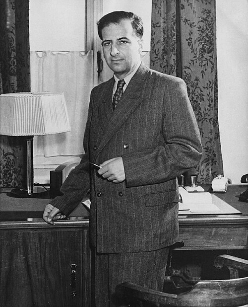

# 布鲁诺·蓬泰科尔沃

**英文名：** Bruno Pontecorvo

**生卒：** 1913年8月22日 — 1993年9月24日

**主要领域：** 中微子物理、核物理

肖像的作者、拍摄或创作年代及具体形式见图片来源。

## 生平简介

意大利出生的物理学家，早年参加费米在罗马的研究团队，曾在法国、北美和英国工作，1950年移居苏联。他将实验技巧与理论直觉结合，是中微子物理的重要先驱。

## 对物理的主要贡献

- 提出利用氯—氩转化探测中微子的放射化学方法
- 率先提出中微子与反中微子及不同中微子态可能发生振荡
- 研究轻子普适性及不同种类中微子

## 肖像来源与许可

- 来源：[Bruno_Pontecorvo_1955.jpg](https://commons.wikimedia.org/wiki/File:Bruno_Pontecorvo_1955.jpg)
- 作者／署名：Unknown author
- 许可：Public domain
- 本地文件：[ce9b81116f91f09a1398.jpg](../portraits/ce9b81116f91f09a1398.jpg)
- 原始来源说明：[1] [2]

## 资料来源

- [Wikipedia: Bruno Pontecorvo](https://en.wikipedia.org/wiki/Bruno_Pontecorvo)

资料整理日期：2026-10-26。
