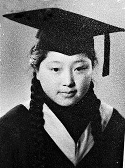

# 何泽慧

**英文名：** He Zehui

**生卒：** 1914年3月5日 — 2011年6月20日

**主要领域：** 核物理、粒子探测

肖像的作者、拍摄或创作年代及具体形式见图片来源。

## 生平简介

出生于江苏苏州的实验物理学家，清华大学毕业后赴德国留学，并在法国开展核裂变实验。1948年与钱三强回国，长期在中国科学院从事核物理、宇宙线与探测器研究。

## 对物理的主要贡献

- 与钱三强等研究并发现铀核多体裂变现象
- 发展核乳胶及粒子探测技术
- 推动中国宇宙线、高能物理和空间探测实验

## 肖像来源与许可

- 来源：[He_Zehui.jpg](https://commons.wikimedia.org/wiki/File:He_Zehui.jpg)
- 作者／署名：Unknown author
- 许可：Public domain
- 本地文件：[7762a78607eb6bdc74e1.jpg](../portraits/7762a78607eb6bdc74e1.jpg)
- 原始来源说明：中工网

## 资料来源

- [中国科学院高能物理研究所：何泽慧生平](https://ihep.cas.cn/zt/hzh110/mtbd/202402/t20240227_6997191.html)
- [Wikipedia: He Zehui](https://en.wikipedia.org/wiki/He_Zehui)

资料整理日期：2026-10-26。
