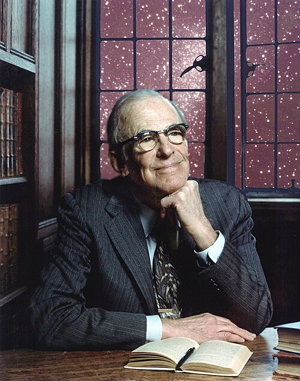

# 莱曼·斯皮策

**英文名：** Lyman Spitzer

**生卒：** 1914年6月26日 — 1997年3月31日

**主要领域：** 等离子体物理、天体物理

肖像的作者、拍摄或创作年代及具体形式见图片来源。

## 生平简介

美国天体物理学家，长期在普林斯顿大学工作。他同时研究星际介质、恒星动力学和聚变等离子体，并较早提出把天文望远镜送入空间。

## 对物理的主要贡献

- 提出仿星器磁约束聚变装置
- 研究星际介质与等离子体输运
- 倡导空间望远镜，推动后来哈勃望远镜项目

## 肖像来源与许可

- 来源：[1946-_Lyman_Spitzer_(4526166350).jpg](https://commons.wikimedia.org/wiki/File:1946-_Lyman_Spitzer_(4526166350).jpg)
- 作者／署名：NASA APPEL Knowledge Services
- 许可：Public domain
- 本地文件：[3a7c23a5073bc04d0d74-3f862d2239.jpg](../portraits/3a7c23a5073bc04d0d74-3f862d2239.jpg)
- 原始来源说明：1946: Lyman Spitzer

## 资料来源

- [Lyman Spitzer — Wikipedia reference biography](https://en.wikipedia.org/wiki/Lyman_Spitzer)

资料整理日期：2026-10-26。
