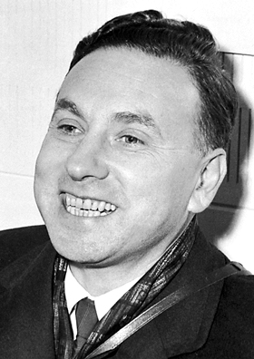

# 罗伯特·霍夫施塔特

**英文名：** Robert Hofstadter

**生卒：** 1915年2月5日 — 1990年11月17日

**主要领域：** 核物理、散射实验

肖像的作者、拍摄或创作年代及具体形式见图片来源。

## 生平简介

罗伯特·霍夫施塔特出生于New York, NY, USA，主要从事核物理、散射实验研究。诺贝尔奖资料所列获奖时任职机构为Stanford University。其代表成果包括以高能电子散射测量原子核的电荷分布，获1961年诺贝尔物理学奖。

## 对物理的主要贡献

- 以高能电子散射测量原子核的电荷分布
- 研究质子和中子的电磁结构

**诺贝尔物理学奖：** 1961

## 肖像来源与许可

- 来源：[Robert_Hofstadter.jpg](https://commons.wikimedia.org/wiki/File:Robert_Hofstadter.jpg)
- 作者／署名：Nobel foundation
- 许可：Public domain
- 本地文件：[95278a3d6ecb8410fbe0.jpg](../portraits/95278a3d6ecb8410fbe0.jpg)
- 原始来源说明：https://nobelprize.org/nobel_prizes/physics/laureates/1961/hofstadter-bio.html

## 资料来源

- [Robert Hofstadter - Facts](https://www.nobelprize.org/prizes/physics/1961/hofstadter/facts/)
- [Nobel Prize official laureate API, id 75](https://api.nobelprize.org/2.1/laureate/75)
- [Wikipedia: Robert Hofstadter](https://en.wikipedia.org/wiki/Robert_Hofstadter)

资料整理日期：2026-10-26。
