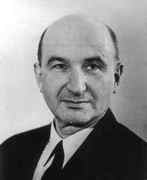

# 叶夫根尼·利夫希茨

**英文名：** Evgeny Lifshitz

**生卒：** 1915年2月21日 — 1985年10月29日

**主要领域：** 凝聚态物理、理论物理

圣安德鲁斯大学MacTutor传记中的本人照片，已目视核对。

## 生平简介

苏联理论物理学家，长期与朗道合作，并参与编写《理论物理学教程》。他将理论方法用于磁性、分子间作用及宇宙学，在科学研究与理论物理教育中影响广泛。

## 对物理的主要贡献

- 与朗道建立磁化动力学的朗道—利夫希茨方程
- 发展宏观介质间色散力的利夫希茨理论
- 参与研究宇宙学奇点附近的动力学

## 肖像来源与许可

- 来源：[thumbnail.jpg](https://mathshistory.st-andrews.ac.uk/Biographies/Lifshitz/)
- 作者／署名：见原图页面
- 许可：版权所有或再发布授权未确认；公开网页使用前须核查授权
- 本地文件：[10fadd9e960119dd73bf-0309f577c8.jpg](../portraits/10fadd9e960119dd73bf-0309f577c8.jpg)
- 授权状态：仅记录来源与本地档案副本；未确认可用于网站再发布，发布前须向权利人核实授权。

## 资料来源

- [Wikipedia: Evgeny Lifshitz](https://en.wikipedia.org/wiki/Evgeny_Lifshitz)

资料整理日期：2026-10-26。
