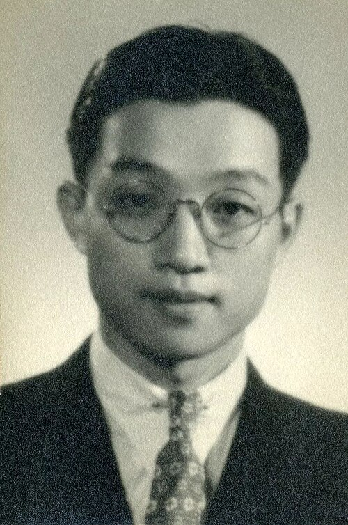

# 王大珩

**英文名：** Wang Daheng

**生卒：** 1915年2月26日 — 2011年7月21日

**主要领域：** 光学、光学工程

王大珩青年时期的肖像，Commons来源页标为1932—1942年间。

## 生平简介

出生于东京、祖籍江苏的光学家，清华大学毕业后赴英国研究光学玻璃，1948年回国。他参与创建长春光学精密机械研究所，推动中国现代光学研究和精密仪器制造。

## 对物理的主要贡献

- 研究光学玻璃及光学材料性质
- 组织发展精密光学仪器、测试和国防光学技术
- 参与倡议高技术研究发展计划并建设中国光学研究体系

## 肖像来源与许可

- 来源：[青年王大珩.jpg](https://commons.wikimedia.org/wiki/File:%E9%9D%92%E5%B9%B4%E7%8E%8B%E5%A4%A7%E7%8F%A9.jpg)
- 作者／署名：不详
- 许可：[Public domain — Commons source tag (PD-China or PD-scan)](https://commons.wikimedia.org/wiki/File:%E9%9D%92%E5%B9%B4%E7%8E%8B%E5%A4%A7%E7%8F%A9.jpg)
- 本地文件：[84ab5a78020f3e106caa-ac4850b05c.jpg](../portraits/84ab5a78020f3e106caa-ac4850b05c.jpg)
- 原始来源说明：Wikimedia Commons；中华全国归国华侨联合会2021年纪念文章所收历史照片

## 资料来源

- [Wikipedia: Wang Daheng](https://en.wikipedia.org/wiki/Wang_Daheng)

资料整理日期：2026-10-26。
