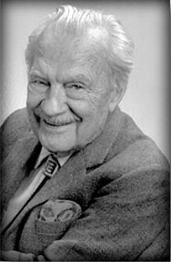

# 尼古拉斯·梅特罗波利斯

**英文名：** Nicholas Metropolis

**生卒：** 1915年6月11日 — 1999年10月17日

**主要领域：** 计算物理、统计物理

肖像的作者、拍摄或创作年代及具体形式见图片来源。

## 生平简介

美国物理学家，曾参与洛斯阿拉莫斯战时研究并推动电子计算机研制。他与合作者将随机抽样和计算机结合，开辟统计物理与数值模拟的新方法。

## 对物理的主要贡献

- 参与提出广泛用于平衡统计采样的梅特罗波利斯算法
- 推动蒙特卡洛方法在物理中的应用
- 领导MANIAC计算机等早期科学计算工作

## 肖像来源与许可

- 来源：[Nicholas_Metropolis_cropped.PNG](https://commons.wikimedia.org/wiki/File:Nicholas_Metropolis_cropped.PNG)
- 作者／署名：Nicholas_Metropolis.jpeg: Los Alamos National Laboratory derivative work: Avi (talk)
- 许可：Public domain
- 本地文件：[f629adda3cc383b66014.png](../portraits/f629adda3cc383b66014.png)
- 原始来源说明：Nicholas_Metropolis.jpeg

## 资料来源

- [Wikipedia: Nicholas Metropolis](https://en.wikipedia.org/wiki/Nicholas_Metropolis)

资料整理日期：2026-10-26。
