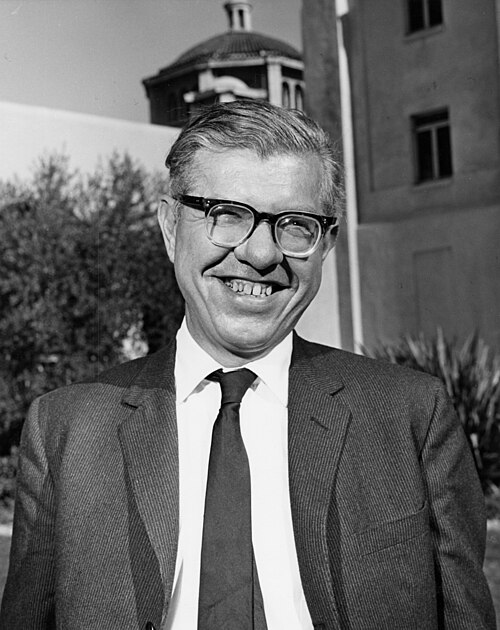

# 弗雷德·霍伊尔

**英文名：** Fred Hoyle

**生卒：** 1915年6月24日 — 2001年8月20日

**主要领域：** 核天体物理、宇宙学

肖像的作者、拍摄或创作年代及具体形式见图片来源。

## 生平简介

英国理论天体物理学家，长期在剑桥工作，并参与建立理论天文学研究机构。他以恒星元素合成研究著称，也提出后来受到观测否定的稳恒态宇宙模型。

## 对物理的主要贡献

- 研究恒星中的核合成并参与B²FH元素起源论文
- 预言碳12中促进恒星合成碳的共振能级
- 与邦迪、戈尔德提出稳恒态宇宙模型

## 肖像来源与许可

- 来源：[Fred_Hoyle_1967.jpg](https://commons.wikimedia.org/wiki/File:Fred_Hoyle_1967.jpg)
- 作者／署名：AIP Emilio Segrè Visual Archives, Clayton Collection
- 许可：Attribution
- 本地文件：[07c93822756f83ceb2da-5c17398d08.jpg](../portraits/07c93822756f83ceb2da-5c17398d08.jpg)
- 原始来源说明：https://repository.aip.org/hoyle-sloan-laboratory

## 资料来源

- [Fred Hoyle — Wikipedia reference biography](https://en.wikipedia.org/wiki/Fred_Hoyle)
- [PHOTO ARCHIVE IN NUCLEAR ASTROPHYSICS](https://astro.sites.clemson.edu/NucleoArchive/PhotoList/1970s/75letterHC.html)

资料整理日期：2026-10-26。
