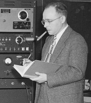

# 克利福德·沙尔

**英文名：** Clifford G. Shull

**生卒：** 1915年9月23日 — 2001年3月31日

**主要领域：** 中子散射、凝聚态物理

肖像的作者、拍摄或创作年代及具体形式见图片来源。

## 生平简介

克利福德·沙尔出生于Pittsburgh, PA, USA，主要从事中子散射、凝聚态物理研究。诺贝尔奖资料所列获奖时任职机构为Massachusetts Institute of Technology (MIT)。其代表成果包括发展中子衍射方法，获1994年诺贝尔物理学奖。

## 对物理的主要贡献

- 发展中子衍射方法
- 利用中子研究物质中的原子位置和磁性结构

**诺贝尔物理学奖：** 1994

## 肖像来源与许可

- 来源：[Wollan and Shull 1949 (cropped).jpg](https://commons.wikimedia.org/wiki/File:Wollan_and_Shull_1949_(cropped).jpg)
- 作者／署名：Photo is from US Atomic Energy Commission or Oak Ridge National Laboratory. Article rights are T. E. Mason et al. 2013 (for Oak Ridge National Laboratory).
- 许可：[CC BY 3.0](https://creativecommons.org/licenses/by/3.0)
- 本地文件：[dfbe340795b0e18d76f7.jpg](../portraits/dfbe340795b0e18d76f7.jpg)
- 原始来源说明：cropped from File:Wollan and Shull 1949.jpghttp://europepmc.org/wicket/bookmarkable/uk.bl.ukpmc.web.utilities.redirect.RedirectPage?figure=fig12/&articles=PMC3526866

## 资料来源

- [Clifford G. Shull - Facts](https://www.nobelprize.org/prizes/physics/1994/shull/facts/)
- [Nobel Prize official laureate API, id 146](https://api.nobelprize.org/2.1/laureate/146)
- [Wikipedia: Clifford Shull](https://en.wikipedia.org/wiki/Clifford_Shull)

资料整理日期：2026-10-26。
