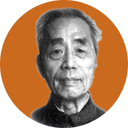

# 胡宁

**英文名：** Hu Ning

**生卒：** 1916年2月11日 — 1997年12月26日

**主要领域：** 量子场论、粒子物理

肖像的作者、拍摄或创作年代及具体形式见图片来源。

## 生平简介

出生于江苏宿迁的理论物理学家，曾在加州理工学院、普林斯顿、都柏林和哥本哈根研究，后长期任教于北京大学。他研究核力、散射矩阵及强子结构，并培养中国理论物理人才。

## 对物理的主要贡献

- 研究介子核力与相对论量子场论
- 与朱洪元等发展强子层子模型
- 编写电动力学和场论教材并建设理论物理研究队伍

## 史料说明

- 部分外文网页将死亡日期误记为12月16日；本档案采用北京大学纪念传记中的1997年12月26日。

## 肖像来源与许可

- 来源：[modern-extra-hu-ning.jpg](https://www.xsg.pku.edu.cn/heros/scholar/detail/553.html)
- 作者／署名：见原图页面
- 许可：Copyrighted image; no transferable open licence verified. Permission must be confirmed before website publication.
- 本地文件：[1f322429d1ce9d3efa97-2469d70318.jpg](../portraits/1f322429d1ce9d3efa97-2469d70318.jpg)
- 原始来源说明：Peking University History Museum
- 授权状态：仅记录来源与本地档案副本；未确认可用于网站再发布，发布前须向权利人核实授权。

## 资料来源

- [Hu Ning — Peking University History Museum](https://www.xsg.pku.edu.cn/heros/scholar/detail/553.html)
- [Hu Ning — Peking University memorial biography](https://news.pku.edu.cn/xwzh/129-119217.htm)
- [Hu Ning — Wikipedia reference biography](https://en.wikipedia.org/wiki/Hu_Ning)

资料整理日期：2026-10-26。
