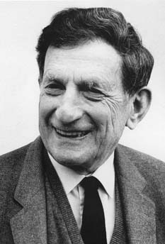

# 戴维·玻姆

**英文名：** David Bohm

**生卒：** 1917年12月20日 — 1992年10月27日

**主要领域：** 量子基础、等离子体物理

肖像的作者、拍摄或创作年代及具体形式见图片来源。

## 生平简介

美国出生的理论物理学家，曾任教于普林斯顿大学，因政治迫害离开美国，先后在巴西、以色列和英国工作。他研究等离子体及量子理论诠释，推动对非局域性的讨论。

## 对物理的主要贡献

- 发展具有确定粒子轨迹的玻姆量子理论
- 与阿哈罗诺夫提出电磁势可观测效应
- 研究等离子体集体运动及量子多体理论

## 肖像来源与许可

- 来源：[David_Bohm.jpg](https://commons.wikimedia.org/wiki/File:David_Bohm.jpg)
- 作者／署名：Unknown photographer
- 许可：Attribution
- 本地文件：[6331cd843135e88c9159.jpg](../portraits/6331cd843135e88c9159.jpg)
- 原始来源说明：image taken from this page. Transferred from en.wikipedia to Commons. The original uploader was Karol Langner at English Wikipedia.

## 资料来源

- [Wikipedia: David Bohm](https://en.wikipedia.org/wiki/David_Bohm)

资料整理日期：2026-10-26。
