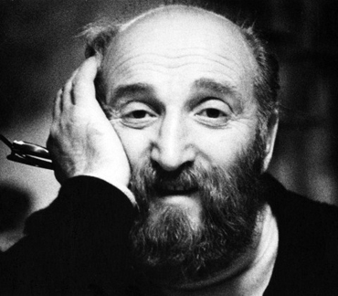

# 格尔什·布德克尔

**英文名：** Gersh Budker

**生卒：** 1918年5月1日 — 1977年7月4日

**主要领域：** 加速器物理、等离子体物理

俄罗斯科学院西伯利亚分院图书馆的布德克尔专题中标注为Будкер Г.И.的本人照片。

## 生平简介

苏联物理学家，创建并领导新西伯利亚核物理研究所。他重视理论与装置研发结合，在电子正电子储存环、束流控制和受控聚变研究中开展了开创性工作。

## 对物理的主要贡献

- 提出并发展重粒子束电子冷却方法
- 推动正负电子对撞机与储存环研究
- 研究等离子体约束及集体加速技术

## 肖像来源与许可

- 来源：[budker.jpg](https://www.prometeus.nsc.ru/science/schools/budker/about.ssi)
- 作者／署名：见原图页面
- 许可：俄罗斯科学院图书馆历史照片；再发布授权未确认
- 本地文件：[5a1e3ee80776dd325d3a-bb9586b3fe.jpg](../portraits/5a1e3ee80776dd325d3a-bb9586b3fe.jpg)
- 授权状态：仅记录来源与本地档案副本；未确认可用于网站再发布，发布前须向权利人核实授权。

## 资料来源

- [Wikipedia: Gersh Budker](https://en.wikipedia.org/wiki/Gersh_Budker)

资料整理日期：2026-10-26。
