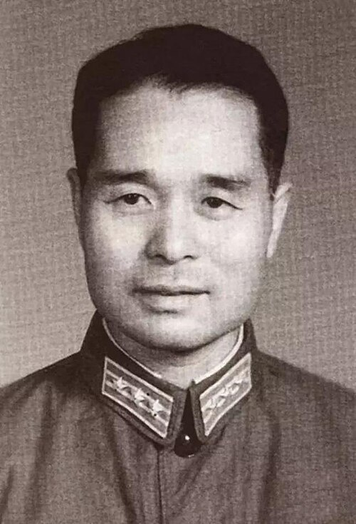

# 程开甲

**英文名：** Cheng Kaijia

**生卒：** 1918年8月3日 — 2018年11月17日

**主要领域：** 固体物理、核试验物理

程开甲刚进入核试验基地时期的肖像，Commons来源页标为1960年代。 Commons文件页仅提供PD-China标记，未列出独立的美国公有领域依据。

## 生平简介

出生于江苏吴江的物理学家，浙江大学毕业后赴英国爱丁堡大学师从玻恩，1950年回国。他早期研究固体理论，后长期组织中国核试验中的物理测量和技术研究。

## 对物理的主要贡献

- 研究固体理论并撰写相关教材
- 主持中国核试验物理与测试技术研究
- 建立多种核爆炸效应测量方法及实验体系

## 肖像来源与许可

- 来源：[年轻程开甲.jpg](https://commons.wikimedia.org/wiki/File:%E5%B9%B4%E8%BD%BB%E7%A8%8B%E5%BC%80%E7%94%B2.jpg)
- 作者／署名：不详
- 许可：Commons标注PD-China；跨境网站再发布授权与适用范围需另行确认
- 本地文件：[ce7b08cf8788345de480-3501af4c54.jpg](../portraits/ce7b08cf8788345de480-3501af4c54.jpg)
- 原始来源说明：Wikimedia Commons；文汇网历史资料图片
- 授权状态：仅记录来源与本地档案副本；未确认可用于网站再发布，发布前须向权利人核实授权。

## 资料来源

- [中国科学院：程开甲](https://www.cas.cn/xzfc/202110/t20211018_4809933.shtml)
- [Wikipedia: Cheng Kaijia](https://en.wikipedia.org/wiki/Cheng_Kaijia)

资料整理日期：2026-10-26。
